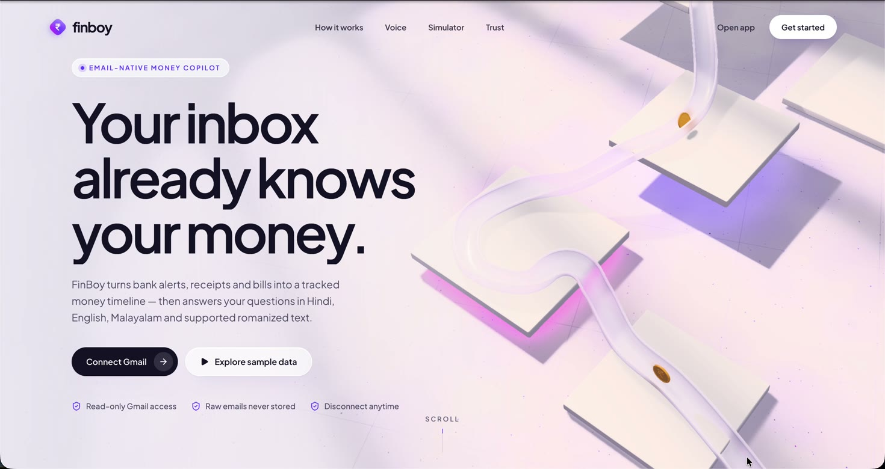
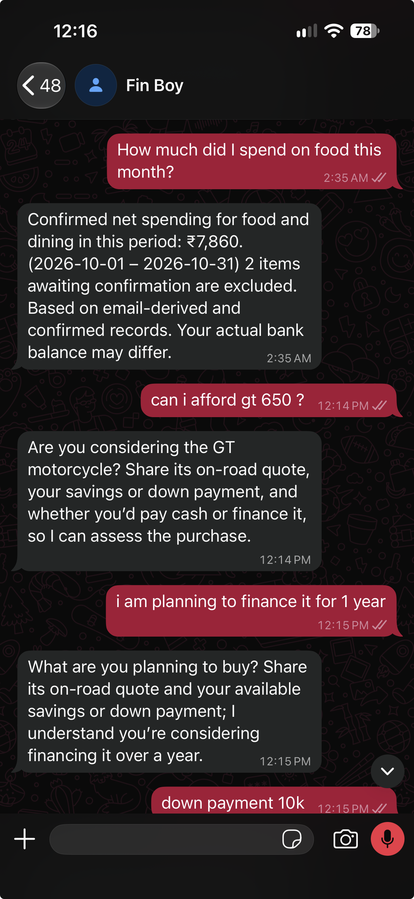

# FinBoy

## Live site and demo

- [Open FinBoy](https://finboy.antlegs.in)
- [Watch the product demo (MP4, 68 seconds)](https://github.com/Sahal-P/ai_boomi_frontend/releases/download/demo-2026-10-24/finboy-demo.mp4)

[](https://github.com/Sahal-P/ai_boomi_frontend/releases/download/demo-2026-10-24/finboy-demo.mp4)

### WhatsApp conversation



FinBoy imports Gmail, saved `.eml` files, or a synthetic demo mailbox into an
evidence-backed ledger. A deterministic money engine provides tracked income,
confirmed net spending, commitments and cash-flow simulations. Review/correction,
privacy controls, and an English/Hindi/Malayalam text/voice assistant share the same
records. WhatsApp supports approved-sender ledger questions and screenshot capture;
hand-enrolled village pilot households also record money and dues by Hindi voice and
confirm them by button ([pilot contract](docs/pilot/contract.md)).

The assembled product is merged into **main** and published to both requested repositories.
The authorized private production site is **https://finboy.antlegs.in**, with its
backend on voxpay at **https://finboy-api.antlegs.in**. See [production operations](docs/production.md).
Development integration history remains on **feat/finboy-integration**. Its frozen
baseline **feat/finboy-ready-base** is
`fd618aef74336279e587748b216374d20cc892ad`. See
[parallel completion](docs/phase1/parallel-completion.md), the frozen
[financial/API contract](docs/phase1/contract.md), and
[demo runbook](docs/demo-runbook.md). Read the final handoff for remaining live
acceptance gaps; provider configuration alone never means completion.

## Stack and boundaries

- Python 3.15.1, uv, FastAPI/Pydantic v2, SQLAlchemy 2, Alembic, PostgreSQL.
- Next.js App Router, React, strict TypeScript, pnpm, Tailwind/shadcn, Lucide.
- Glass design system measured from a reference: frosted glass on a fixed field, a sunflower
  money hero, yellow moments with drawn line-art illustrations, and dotted thinking orbs
  (2D canvas) while FinBoy's AI works. Lazy R3F/three scenes remain in the landing page's lower
  sections with DOM-first controls, reduced motion and no-WebGL fallback.
- Backend-only OpenAI extraction, assistant understanding/wording and STT. Configured
  assistant requests use real AI; financial figures remain engine-calculated.
  `SPEECH_TRANSCRIBE_PROVIDER=groq` sends
  English/Hindi to Groq `whisper-large-v3-turbo`; Malayalam always stays on OpenAI.
  OpenAI vision reads WhatsApp payment screenshots into the review queue. Resemble Ultra
  English/Hindi (human's final provider choice), verified Gemini Malayalam TTS. System
  ffmpeg/ffprobe validate/transcode real media. No cloning or training.
- One API, one web app, PostgreSQL as the only persistent service. Stateless
  webhook-only ingress may forward exactly GET/POST /api/v1/whatsapp/webhook.
  Local product APIs remain loopback-only. Authorized production uses a household
  session gate and an HTTPS proxy; finance/privacy routes reject unauthenticated users.

Money stays integer paise in INR and dates use IST. Production supports private
household login only. No public signup, bank API, WhatsApp merges/deletions, automatic
confirmation (only pilot households confirm, reject or correct the amount of their own
records by an explicit button tap, with undo), stock/fund recommendations, or training.
“Estimated unallocated amount” comes from email-derived and confirmed records;
actual bank balances may differ. Simulations are not investment recommendations.

## Local setup

Use Node 24 LTS (engines allow 22.18–26), pinned pnpm 12.15.0, uv, Docker Compose,
and ffmpeg/ffprobe for voice. Exact packages are in uv.lock and pnpm-lock.yaml.

```sh
uv sync --locked --all-packages
pnpm install --frozen-lockfile
pnpm env:setup
pnpm db:up
# Integration round's disposable database; already-exists is harmless:
docker compose exec -T postgres createdb -U finboy finboy_p5
pnpm db:migrate
FINBOY_EXTRACTION_MODE=offline API_PORT=8015 WEB_PORT=3015 pnpm dev
```

Before migrating, set the ignored backend env to local database **finboy_p5** on
127.0.0.1:5433, exact CORS origins localhost:3015 and 127.0.0.1:3015,
WEB_APP_URL=http://127.0.0.1:3015, DEMO_TODAY=2026-10-28. Web env sets
NEXT_PUBLIC_API_URL=http://127.0.0.1:8015. Preserve the development database role.
Other agents use their own databases/ports as documented. Never stop the shared
PostgreSQL container or delete its volume during parallel work.

`pnpm env:setup` creates private ignored env files without overwriting existing
ones. Secrets belong only in ~/.config/finboy/secrets.env and ignored backend env,
mode 600. No secret values go in NEXT_PUBLIC variables, source, logs or screenshots.
Copy only required private settings directly; never print them. All model/voice IDs
are backend settings; missing providers give explicit unavailable/text-only states.

The demo uses 42 synthetic messages and actual recorded extraction responses.
`FINBOY_EXTRACTION_MODE=offline` replays recordings (model must match the manifest);
`rules` uses deterministic extraction. Normal configured imports can use live
extraction. Do not rerecord or invoke costly live evaluation without necessity.

## Commands

| Command | Purpose |
| --- | --- |
| pnpm check / pnpm build | Lint, unit tests, strict web types / production build |
| pnpm db:migrate / pnpm db:check | Additive migrations / schema drift check |
| pnpm test:integration | Real local PostgreSQL persistence/HTTP/concurrency tests |
| pnpm test:system | Actual imports → finance → multilingual assistant → privacy tests |
| pnpm eval:extraction | Offline strict recorded extraction evaluation |
| pnpm voice:benchmark | Offline intent and actual fixture-media validation |
| pnpm demo:render-mailbox --anchor 2026-10-28 | Render synthetic mailbox; does not seed SQL totals |
| pnpm seed:gmail-demo-inbox | Separate insert-only OAuth seeder; human consent |
| pnpm dev:whatsapp-ingress | Exact webhook-only loopback proxy (API_PORT / WHATSAPP_INGRESS_PORT) |
| pnpm final:check-env | Explicitly validate final local finboy/8000/3000 setup |
| pnpm final:db:migrate | Apply additive migrations to reviewed final local finboy |
| pnpm dev:final-api | Start assembled API on registered Gmail callback 8000 |
| pnpm build:final-web / pnpm start:final-web | Build for API 8000 / serve web 3000 |

Final launch does not rewrite p5 env. It refuses production/remote/unexpected
settings. Review the runbook before using it and preserve other running ports.
No startup creates tables; 0002_phase1 seeds the local user, 0003_whatsapp adds
only minimal consent/receipt/delivery metadata. Product records must be generated
through the actual import pipeline, never by inserting expected demo totals.

Open /connect → Load demo mailbox. Progress reports real work; then dashboard,
transactions, review and assistant consume actual stored records. Sources/evidence
and user revision history remain inspectable. Re-import is idempotent and preserves
user decisions. Privacy deletion removes imported evidence/orphaned ledger records
and extraction cache, preserving audit history. Use it on the reviewed disposable
application environment when resetting the demo; do not drop databases/tables.

## External setup and acceptance

[Gmail setup](docs/gmail-setup.md): read-only application scope; seeder insert-only
scope is separate. OAuth app remains Testing, refresh tokens expire after seven
days. Registered Gmail callbacks are 8000/8002, not 8015. A2's previous grant was
revoked deliberately; the human reconnects before a live demo.

[Voice](docs/voice.md): actual provider capability checks, stock voices and benchmark
limits. Browser records at most 30 s / 3 MB into memory, gives an editable transcript,
and requests speech separately. Human performs mic permissions; no fake audio.

[WhatsApp](docs/whatsapp.md): existing Meta app/portfolio, approved test sender
allowlist, signature/context checks, temporary token expiry, restricted tunnel,
metadata-only persistence and durable duplicate suppression. Accepted Graph sends
are distinct from delivered/read replies; confirm actual receipt on the approved
phone. No arbitrary send endpoint, broad public API tunnel, or production publishing.

[Village pilot](docs/pilot/contract.md): Hindi WhatsApp-first pilot for at most 10
hand-enrolled households (4 plus the owner on the Meta test number), consent card, voice
records through review, dues, opt-in reminders, "हिसाब" summaries and the counts-only
`pilot.cli report`. Enrollment, templates and erasure are operator steps.

Human performs login/2FA/CAPTCHA/consent/billing. Identify browser profiles by account
and stable identity, not numeric IDs after restart. Never send tests to unapproved
recipients. Do not push, deploy or merge into main without the requested approval.

## Operations and documentation

Health: /api/v1/health reports core/database availability. Readiness:
/api/v1/readiness distinguishes schema, tools and provider configuration; it explicitly
does not claim live acceptance. BackgroundTasks are in-process and not durable.
Memory-only work cannot replay after restart; stale imports/tasks are marked failed/
interrupted. Responses are no-store, have generated request IDs, and expose fixed
errors. Structured logs omit bodies, URLs/query strings, secrets, SQL parameters,
exception text and financial content.

See [architecture](docs/architecture.md), [extraction](docs/extraction.md),
[money](docs/money.md), [product UI](docs/product-ui.md),
[design system](docs/design-system.md), [integration handoff](docs/handoffs/agent-5.md).
The original design worktree and the pre-existing A2 .gitignore edit are preserved.

## UX trust and recovery round

[API contract and synthetic examples](docs/ux-round/api-contract.md) describe the
isolated read-only demo, overdue liabilities, honest manual scan coverage, versioned
review/undo, history pagination, recoverable extraction and private export/deletion
previews. [Source isolation operations](docs/ux-round/data-isolation-operations.md)
include a read-only aggregate inventory command and non-destructive migration policy.
The [F01–F38 map](docs/ux-round/implementation-map.md) distinguishes backend, Product,
assembled browser and human acceptance. Never use the old demo import to populate a
household ledger. Local UX disposable databases are finboy_ux_api and finboy_ux_ui;
all existing production and shared-service protections remain binding.
