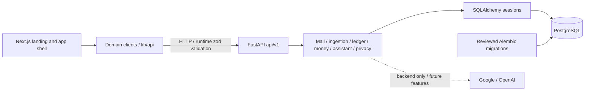

# Phase 1 architecture

FinBoy keeps one FastAPI app, one Next.js App Router app, PostgreSQL, and one
lockfile per ecosystem. [The shared contract](phase1/contract.md) defines scope,
interfaces, ownership, isolated ports/databases, and the demo truth table.

The diagram shows Phase 1 boundaries. Only health works end to end in the scaffold;
domain routers are empty and ingestion, reconciliation, and money interfaces raise
`NotImplementedError`. App routes contain headings and accessible navigation.
No authentication, provider calls, ingestion, money calculations, or demo data are
implemented here. The root evaluation/seed scripts point to modules their owners
will add. Synthetic fixtures belong in `apps/api/fixtures/`.

## Backend

- `api` owns HTTP contracts and translates requests/responses; synchronous routes
  run blocking database work in FastAPI's thread pool.
- `services` owns business logic and write transaction boundaries. Future ingestion
  uses `BackgroundTasks` and `import_runs` counters, with no additional queue service.
  LLMs interpret; deterministic money services calculate; users review uncertainty.
- `db` owns the engine, request sessions, typed models, and metadata. Sessions close
  without auto-commit. Alembic imports every model; only reviewed migrations change
  schema. `0002_phase1` creates 11 tables, seeds the local user Arun, and preserves
  UUIDs, integer paise, INR checks, timezone-aware timestamps, JSONB evidence, and
  reconciliation links. No raw email body column exists. See contract §5 for details.
- `core` owns settings, IST clock, allowlisted structured logging, error envelopes,
  and request context. `today_ist()` honors the demo date only outside production;
  `now_ist()` always returns real time for audit records.

Application construction opens no database connection. Lifespan disposes the
engine. Health returns uncached `200/ok/connected` or `503/degraded/unavailable`;
it checks connectivity, while Alembic commands check migration state.

## Frontend

Pages/layouts are Server Components. The landing connection panel uses a small
hook for initial, 30-second, and manual refresh plus cancellation. It renders
checking, connected, degraded, and offline states.

`src/lib/api/http.ts` owns `requestJson(path, schema, init)`, backend URL validation,
zod response validation, safe `ApiError`, a five-second default timeout,
`credentials: "omit"`, and uncached requests. Optional status schemas support the
health endpoint's consistent 200/503 contract. Each domain gets its own module;
`health.ts` is implemented. Components remain presentational.

The `(app)` route group provides minimal navigation and placeholders without
changing `/`. Theme tokens and local Geist fonts preserve the landing design.
The requested shadcn components are installed for subsequent feature owners.

## Configuration and privacy

Local env files are ignored; committed examples contain blank integration values
and public local database settings. Secrets belong only in
`~/.config/finboy/secrets.env` and ignored env files. OpenAI and OAuth secrets never
enter browser bundles. Configured Fernet keys are validated; a configured
`WEB_APP_URL` must match a CORS origin. Integration settings remain optional so
health and scaffold builds need no credentials.

CORS permits explicit origins, GET/POST/PATCH/DELETE/OPTIONS, no credentials, and
exposes generated request IDs. Local listeners bind to loopback. Logs allow only
operational fields, including import run/stage/count/provider/outcome/model/latency.
Bodies, query strings, tokens, SQL parameters, and raw exception text stay redacted.
Existing errors keep the same safe envelope and request ID.

## Parallel work and verification

Follow contract §3–4. Each agent uses its assigned ports and database on the shared
Postgres container; never stop it during parallel work. Root scripts accept
`API_PORT` / `WEB_PORT`; each worktree must also update CORS and backend URLs.
The integrator owns shared dependencies, core, migration baseline, and HTTP helper.

`pnpm check` runs lint, unit/client tests, and strict types; `pnpm build` checks the
production build. Database checks use a local disposable database, reviewed Alembic
upgrades, drift checks, and integration tests whose constraint probes roll back.
Browser checks cover desktop/mobile navigation and the health panel's four states.

See [verification](verification.md) for actual outcomes. Scope excludes product
login, Outlook, IMAP, WhatsApp, bank APIs, Gmail watch, security recommendations,
model training, and deployment. New services or shared packages need a concrete use.

## Completion round integration (24 October 2026)

The active completion contract is phase1/parallel-completion.md. Real A1 ingestion
and A2 imports now compose with Agent 1's deterministic money/read-review services,
Agent 3's single assistant/speech implementation, and Agent 4's signed WhatsApp
transport. Agent 5 supplied shared settings/languages, provider unavailable errors,
startup stale-task handling, global no-store, operational readiness, and restricted
final runtime commands. No business arithmetic or provider client is duplicated
in the frontend or WhatsApp adapter. Actual JSON contracts are zod-validated in web.

The premium design was copied as a reviewed uncommitted snapshot (hash manifest),
not merged from its stale scaffold HEAD. The human assigned the missing Agent 2
frontend work to Agent 5. The source design worktree remains untouched. Web hooks
own runtime state/communication; presentational components render backend facts.
Microphone recording/transcripts/audio URLs stay ephemeral and are released on
replacement/unmount. Marketing examples are synthetic illustrations.

0003_whatsapp is additive on 0002_phase1 and adds three metadata-only tables.
The public stateless ingress forwards only exact webhook GET/POST to a fixed
loopback API upstream. Product/financial routes remain private. Shared PostgreSQL
and other agents' listeners are preserved. Current live provider/delivery acceptance
and residual gaps belong in handoffs/agent-5.md rather than health assumptions.
