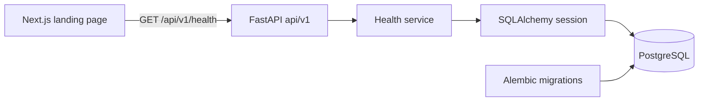

# Phase 0 architecture

FinBoy is a two-application monorepo, sized for a 20-hour hackathon. pnpm manages
the web workspace and root commands; uv manages the Python workspace and its
single API package. Each ecosystem has one root lockfile.

## Backend boundaries

- `api` translates HTTP requests/responses and declares versioned Pydantic contracts.
- `services` holds application logic. The health service executes `SELECT 1` and
  maps database failure to a safe degraded status. It has no HTTP dependency.
- `db` provides typed SQLAlchemy 2 metadata, an engine per application, and a session
  per request. Blocking work runs in FastAPI's thread pool through synchronous
  routes. The engine uses pre-ping, bounded connection/pool/statement timeouts, and
  hidden SQL parameters. Sessions close without automatically committing writes.
- `core` owns validated settings, a JSON log formatter, request context middleware,
  and centralized error responses. `create_app` assembles these parts; its lifespan
  disposes of the engine on shutdown. Importing modules does not open a database.

The health endpoint is a readiness check: `200` means both the API and database
respond; `503` means the API responds but the database is unavailable. It does not
verify the migration revision; `db:current` and `db:check` cover that separately.
Application startup remains possible during a database outage so readiness and
the landing shell can explain the failure.

Alembic alone changes schema. The initial no-op revision establishes migration
history and its version table without inventing financial domain models. Future
models must inherit `Base` and be imported in `alembic/env.py` before autogeneration.

## Frontend boundaries

The layout and landing page are Server Components. Only the live connection panel
is a Client Component. The page is safe to prerender and build without a running
backend. Fonts are packaged locally; builds do not fetch Google Fonts.

`lib/api.ts` owns the public backend URL, an explicitly typed health contract,
runtime response validation, a five-second abort timeout, and safe client errors.
It accepts only consistent `200/ok/connected` or `503/degraded/unavailable` results.
There is no generic request framework or unchecked JSON assertion.

`hooks/use-health.ts` owns connection state, initial/30-second/manual refresh, and
request cancellation on refresh/unmount. UI components render checking, connected,
degraded, and offline states. Browser requests exercise the real API and CORS;
there is no mock status or proxy that hides connectivity problems.

Tailwind theme tokens define off-white, charcoal, and emerald colors. shadcn/ui
components live in the repository, configured through `components.json`. Lucide
provides icons. The illustration is decorative HTML/CSS with no financial data.

## Configuration, privacy, and errors

Compose, FastAPI, and Next.js each load their own local environment file. Examples
are committed; local files are ignored. Settings and database URLs are secret
types. CORS allows exact configured origins and no credentials. Local services
bind only to loopback.

Request middleware generates its own UUID, returns it as `X-Request-ID`, and logs
only method, route **template**, status, and duration. Unmatched paths are a fixed
label. Unexpected exceptions are caught before the server can print their content;
the response contains a generic message and the request ID. HTTP exception details
and validation input are also redacted. Third-party log messages and tracebacks
are omitted by the formatter to avoid accidentally exposing sensitive input.

`OPENAI_API_KEY` is an unused backend-only placeholder. No OpenAI SDK or call is
needed in Phase 0. Future AI logic must live in backend services and never expose
keys or financial records through browser code, responses, or logs.

## Verification and deliberate limits

`pnpm check` covers Ruff formatting/lint, pytest with direct HTTPX ASGI requests,
typed client contract tests, ESLint, and strict TypeScript checks. Integration tests
exercise local PostgreSQL and the baseline revision. `pnpm build` independently
checks the production Next.js build. Browser checks cover responsive layout and
the live health connection, including failure and recovery.

There is no authentication, user data, capture flow, extraction, WhatsApp, ledger,
dashboard, forecast, queue, cache, or deployment infrastructure. Those require a
separate phase. Keep business logic out of API routes and UI; introduce shared
packages or additional services only when concrete requirements justify them.

## Official references

- [Next.js App Router installation](https://nextjs.org/docs/app/getting-started/installation)
- [FastAPI settings](https://fastapi.tiangolo.com/advanced/settings/)
- [Pydantic Settings](https://docs.pydantic.dev/latest/concepts/pydantic_settings/)
- [SQLAlchemy 2.1 sessions](https://docs.sqlalchemy.org/en/21/orm/session_basics.html)
- [Alembic tutorial](https://alembic.sqlalchemy.org/en/latest/tutorial.html)
- [shadcn/ui for Next.js](https://ui.shadcn.com/docs/installation/next)
- [Tailwind CSS installation](https://tailwindcss.com/docs/installation/framework-guides/nextjs)
- [uv workspaces](https://docs.astral.sh/uv/concepts/projects/workspaces/)
- [pnpm workspace settings](https://pnpm.io/settings)
- [typescript-eslint supported versions](https://typescript-eslint.io/users/dependency-versions/)
- [PostgreSQL supported versions](https://www.postgresql.org/support/versioning/)
